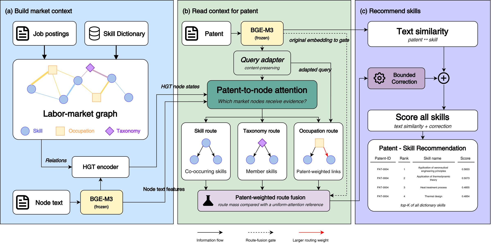

# lara-skills

**LARA** (Labor-market-Aware Relational Attention) reads a technology description, such as a patent abstract, and retrieves the relevant skills from a complete skill dictionary. Instead of matching text alone, it conditions the retrieval on a labor-market graph built from job postings: skills that co-occur in postings, occupations that demand them, and the dictionary's own taxonomy. A new description attends to those market nodes, routes occupation evidence to skills with description-specific weights, combines three relation routes through a learned gate, and applies a bounded correction to the frozen text similarity. Training uses partial human relevance judgments without treating unjudged skills as negatives.

This repository packages the architecture and the data pipeline so that the method can be rebuilt for another labor market from a skill dictionary, job postings with occupation codes, and technology descriptions with relevance judgments. A synthetic toy dataset runs end to end on a laptop CPU in about 20 seconds. The Korean research data and trained checkpoints are not distributed; see [docs/reproducing_the_paper.md](docs/reproducing_the_paper.md).

## Architecture



1. **Labor-market graph and node features.** Job postings and the skill dictionary define a heterogeneous graph of skills (co-occurrence edges), occupations (occupation-skill demand edges) and taxonomy groups (membership and aggregated co-occurrence). Every node carries a frozen text embedding (BGE-M3 by default); a static typed graph attention encoder (HGT-style, with a log edge-weight prior) produces node states.
2. **Patent-conditioned node attention.** The description embedding passes through a content-preserving adapter and attends, per node type, to actual skill, occupation and taxonomy nodes.
3. **Relation routes and fusion.** Attention mass reaches skills through three routes: a skill route over co-occurrence, an occupation route whose occupation-to-skill weights depend on the description, and a taxonomy route. A gate conditioned on the original embedding mixes the routes; the same gate applied to a uniform-attention reference gives a baseline mass, and the log ratio is the graph evidence for each skill.
4. **Skill score.** A decoder over query and skill states plus the graph evidence forms a residual that is bounded by `0.1 * tanh(.)` around the text cosine, so the model starts at the semantic baseline and can only correct it within a corridor. Training minimizes a KL loss against soft targets built from the text similarity distribution with known positives mixed in and explicit negatives removed. The top-K skills are selected from the full dictionary.

The `lara-na` variant keeps the node attention but routes evidence with fixed market weights and equal mass per node type. Component-level details and hyperparameters: [docs/models.md](docs/models.md).

## Results

Numbers come from the manuscript *LARA: Labor-market-aware relational attention for technology-to-skill recommendation* (under review). Data: 7,934,099 Korean job postings (2021-2024), a dictionary of 6,558 skills with a 29/118/464 taxonomy, 450 occupations, and 200 human-labeled patents filed 2019-2023 split 120 / 40 / 40 into train / validation / test. Metrics are computed over the full 6,558-skill list per patent; recall counts known relevant skills only, and unjudged recommendations are never treated as errors. Learned models report the mean over three training seeds.

**Held-out test retrieval (40 patents, 367 known relevant pairs, %).** Recall@5 is mean ± sample SD across seeds.

| Model | Recall@5 | Hit@5 | Recall@20 | Recall@100 |
| --- | ---: | ---: | ---: | ---: |
| BGE similarity (non-learned) | 9.48 | 57.50 | 15.59 | 33.14 |
| Text MLP | 15.94 ± 0.38 | 80.83 | 38.99 | 66.31 |
| GraphSAGE (skill graph) | 16.64 ± 0.94 | 84.17 | 37.26 | 65.88 |
| GraphSAGE (full graph) | 13.29 ± 1.37 | 67.50 | 34.90 | 62.78 |
| R-GCN | 14.70 ± 2.13 | 76.67 | 30.54 | 57.26 |
| PinSage | 16.99 ± 0.82 | 78.33 | 38.51 | 63.63 |
| HGT | 16.94 ± 0.71 | 80.83 | 39.50 | 68.12 |
| Taxonomy GNN | 13.64 ± 1.48 | 71.67 | 35.77 | 64.43 |
| LARA-NA (`lara-na`) | 18.60 ± 1.10 | 84.17 | 41.11 | 68.26 |
| **LARA (`lara`)** | **20.86 ± 0.90** | **87.50** | **44.26** | **72.82** |

Within-seed increments of LARA over Text MLP, HGT and LARA-NA are 4.92 ± 1.26, 3.93 ± 0.19 and 2.26 ± 0.45 percentage points.


**Skills that semantic similarity misses.** Among the 334 known relevant pairs outside the BGE top five, LARA recovers 15.94 ± 0.83 % at K = 5, compared with 11.74 ± 0.34 % for Text MLP, 11.53 ± 1.05 % for HGT and 13.57 ± 1.12 % for LARA-NA. Relative to Text MLP, LARA retrieves 24.00 additional positive pairs on average while losing 8.67. Across similarity bins defined on training data, LARA and Text MLP are close in the low bin (10.81 vs 10.91 %), while LARA leads in the medium bin (22.23 vs 19.92 %); BGE keeps the highest macro recall in the high bin (37.91 vs 34.37 %).

**Structural ablations (test Recall@5, LARA minus control, percentage points, within matching seeds).**

| Control | Recall@5 | Increment |
| --- | ---: | ---: |
| LARA | 20.86 ± 0.90 | – |
| without occupation relations | 19.95 ± 1.11 | +0.91 ± 1.45 |
| without skill co-occurrence | 21.10 ± 0.83 | −0.24 ± 1.09 |
| without all posting relations | 19.46 ± 1.01 | +1.41 ± 1.46 |
| degree-preserving rewiring | 21.65 ± 0.71 | −0.79 ± 0.20 |
| fixed occupation routing | 20.43 ± 0.59 | +0.43 ± 1.44 |

Removing posting relations or fixing occupation routing lowers recall, but a rewired graph performs slightly better than the observed one, so the results support the complete architecture without establishing that the exact observed edge arrangement is necessary. On the validation set, LARA's advantage over Text MLP holds at every training size from 30 to 120 patents (+3.0 to +4.3 points). Full tables and the remaining figures: [docs/results.md](docs/results.md).

## Install

Python 3.11 or newer. PyTorch is a dependency; a CPU build suffices for the toy data.

```bash
pip install git+https://github.com/SimGGG/lara-skills                                   # library + lara-skills command
pip install "lara-skills[bge] @ git+https://github.com/SimGGG/lara-skills"             # adds sentence-transformers (BGE-M3)
```

## Usage

```bash
lara-skills quickstart --workspace lara_toy_workspace                 # toy data, build, evaluate, recommend (CPU, ~20 s)
lara-skills toy-data --output my_market                               # template inputs and lara_app.json for your data
lara-skills build --config my_market/lara_app.json --device cuda      # 11 stages from raw inputs to a trained engine
lara-skills evaluate --config my_market/lara_app.json --split validation
lara-skills recommend --config my_market/lara_app.json --text "Apparatus for laser welding of aluminum battery housings ..." --top-k 10
```

Inputs are a skill dictionary (code, name, taxonomy columns), yearly posting files (source, posting id, year, month, occupation code, skill codes), an occupation table, and technology descriptions with relevance judgments (grades 0/1/2, withheld judgments kept separately); column names, separators and thresholds are set in `lara_app.json` ([docs/data_contracts.md](docs/data_contracts.md)). Add `--variant lara-na` to train the simpler variant. Stages are resumable and never overwrite existing outputs ([docs/pipeline.md](docs/pipeline.md)). The toy quickstart uses a hashed n-gram encoder so that nothing is downloaded; it checks the pipeline, not recommendation quality ([docs/toy_dataset.md](docs/toy_dataset.md)).

```python
from lara_skills import RecommendationEngine

engine = RecommendationEngine("my_market", "artifacts/models/v1_lara", device="cpu")
engine.recommend_table("Apparatus for laser welding of aluminum battery housings ...", top_k=10)
```

## Citation

See [CITATION.cff](CITATION.cff). Please cite the software and the manuscript.

## License

MIT, see [LICENSE](LICENSE).
