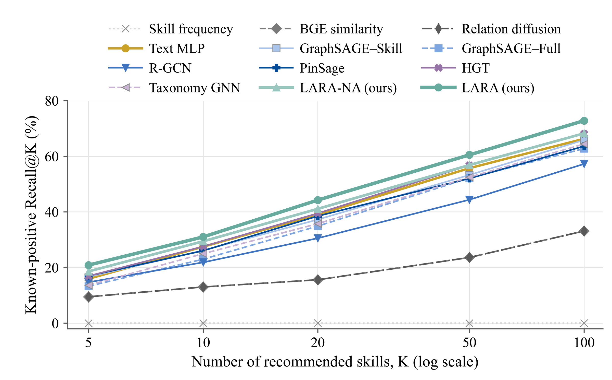
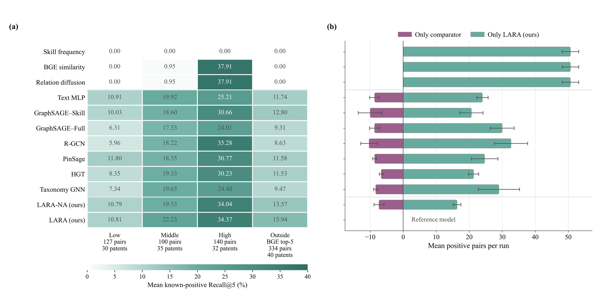
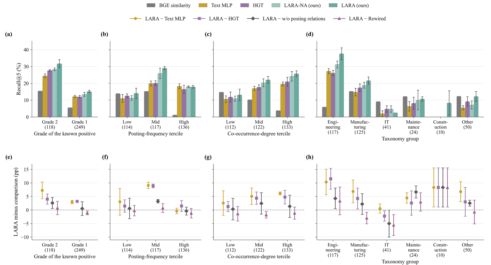
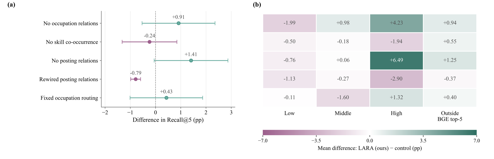
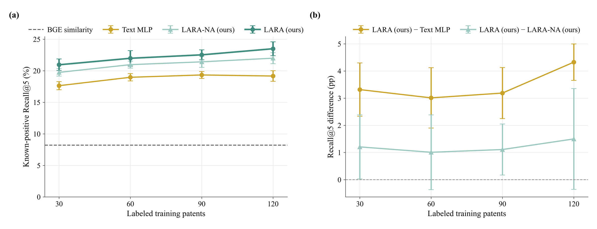

# Results from the manuscript

All numbers are taken from *LARA: Labor-market-aware relational attention for technology-to-skill recommendation* (under review). They were produced with the research code on the Korean data described in [reproducing_the_paper.md](reproducing_the_paper.md); this package cannot reproduce them without that data.

## Data and evaluation units

| Item | Value |
| --- | --- |
| Labor-market data | Korean job postings, 2021-2024; 7,934,099 postings after duplicate removal |
| Patents | Granted Korean patents filed 2019-2023 in the foundational technology industries; 40 per year, 200 in total |
| Candidate skills | Entire skill dictionary, 6,558 skills |
| Graph nodes | 6,558 skills, 450 occupations, 29 / 118 / 464 taxonomy groups |
| Graph relations | occupation-skill, skill co-occurrence, taxonomy membership, aggregated group co-occurrence |
| Train / validation / test | 120 / 40 / 40 patents |
| Known relevant pairs | 1,040 (train), 352 (validation), 367 (test); one explicit negative per split |
| Relevant skill | human grade 1 or 2, the higher grade given under the development and the use of the technology |
| Evaluation unit | full-dictionary recommendation list per patent |

Learned models were trained three times with different random initializations (seeds 42, 43, 44); checkpoints were selected on validation known-positive Recall@5 and evaluated once on the sealed test set. Means and sample SDs are over the three runs; paired increments are computed within each run before averaging. The SD describes training variation, not a confidence interval. Bold marks the best value per column.

## Full-dictionary retrieval on the test set (RQ1, %)

Recall@5 is mean ± sample SD across runs; other columns are means. Skill frequency, which retrieves no known positive at any cutoff, is omitted.

| Model | Recall@5 | Hit@5 | Recall@20 | Recall@100 |
| --- | ---: | ---: | ---: | ---: |
| BGE similarity | 9.48 | 57.50 | 15.59 | 33.14 |
| Relation diffusion | 9.48 | 57.50 | 15.59 | 33.14 |
| Text MLP | 15.94 ± 0.38 | 80.83 | 38.99 | 66.31 |
| GraphSAGE (skill graph) | 16.64 ± 0.94 | 84.17 | 37.26 | 65.88 |
| GraphSAGE (full graph) | 13.29 ± 1.37 | 67.50 | 34.90 | 62.78 |
| R-GCN | 14.70 ± 2.13 | 76.67 | 30.54 | 57.26 |
| PinSage | 16.99 ± 0.82 | 78.33 | 38.51 | 63.63 |
| HGT | 16.94 ± 0.71 | 80.83 | 39.50 | 68.12 |
| Taxonomy GNN | 13.64 ± 1.48 | 71.67 | 35.77 | 64.43 |
| LARA-NA | 18.60 ± 1.10 | 84.17 | 41.11 | 68.26 |
| **LARA** | **20.86 ± 0.90** | **87.50** | **44.26** | **72.82** |

Relation diffusion equals BGE similarity because validation selected a diffusion strength of zero. Paired increments of LARA over Text MLP, HGT and LARA-NA: 4.92 ± 1.26, 3.93 ± 0.19 and 2.26 ± 0.45 percentage points. These are differences between complete architectures; they do not isolate the effect of a specific relation.

## Recall by similarity bin (RQ2, test Recall@5, %, mean ± SD)

Low, middle and high bins are defined by the BGE cosine of training positives (127, 100 and 140 test pairs); the last column is the overlapping subset of 334 positives outside each patent's BGE top five.

| Model | Low | Middle | High | Outside BGE top-5 |
| --- | ---: | ---: | ---: | ---: |
| BGE similarity | 0.00 | 0.95 | **37.91** | 0.00 |
| Relation diffusion | 0.00 | 0.95 | **37.91** | 0.00 |
| Text MLP | 10.91 ± 0.34 | 19.92 ± 0.89 | 25.21 ± 1.54 | 11.74 ± 0.34 |
| GraphSAGE (skill graph) | 10.03 ± 1.72 | 18.60 ± 2.34 | 30.66 ± 3.89 | 12.80 ± 1.55 |
| GraphSAGE (full graph) | 6.31 ± 2.73 | 17.53 ± 0.73 | 24.01 ± 4.10 | 9.31 ± 1.07 |
| R-GCN | 5.96 ± 2.06 | 18.22 ± 2.73 | 35.28 ± 3.77 | 8.63 ± 1.55 |
| PinSage | **11.80 ± 0.68** | 18.35 ± 1.73 | 30.77 ± 1.59 | 11.58 ± 1.48 |
| HGT | 8.35 ± 2.03 | 19.33 ± 2.00 | 30.23 ± 3.75 | 11.53 ± 1.05 |
| Taxonomy GNN | 7.34 ± 1.52 | 19.65 ± 1.44 | 24.40 ± 3.05 | 9.47 ± 1.38 |
| LARA-NA | 10.79 ± 1.44 | 19.33 ± 2.36 | 34.04 ± 1.13 | 13.57 ± 1.12 |
| LARA | 10.81 ± 0.36 | **22.23 ± 1.17** | 34.37 ± 1.50 | **15.94 ± 0.83** |

Relative to Text MLP, LARA retrieves 24.00 additional positive pairs outside the BGE top five while losing 8.67 (net +15.33); relative to HGT the counts are 21.33 and 6.67, relative to LARA-NA 16.33 and 7.33. BGE's higher macro recall in the high bin does not contradict LARA recovering more high-bin pairs in absolute terms (41 versus 32 on average): the macro metric divides by each patent's number of positives in the bin first.

### Known positives by skill attribute

The same test lists decomposed by attributes of the relevant skill (boundaries from training positives). Values are paired increments of LARA over Text MLP in Recall@5, percentage points, with the number of relevant pairs in the group.

| Attribute | Groups (pairs) | LARA − Text MLP |
| --- | --- | --- |
| Grade | directly relevant, grade 2 (118); indirectly relevant, grade 1 (249) | +7.24 ± 3.09; +2.96 ± 0.64 |
| Posting-frequency tercile | lowest; middle; highest | +3.06 ± 4.96; +9.09 ± 1.18; −0.37 ± 1.04 |
| Co-occurrence-degree tercile | least connected (includes 12 isolated pairs); most connected | +2.57 ± 4.54; +6.12 ± 0.54 (the middle tercile lies between; see figure) |
| Taxonomy group | engineering; manufacturing and production; information technology (41 pairs, 10 patents) | +10.35 ± 4.70; +6.86 ± 4.21; +0.56 ± 1.73 |

In the highest posting-frequency tercile Text MLP reaches 18.30 % and LARA a similar value; for information-technology skills LARA's recall (2.50 %) lies 5.00 points below the control without posting relations. The analysis does not identify why. Groups overlap, and differences between groups are not causal effects of the attribute.

## Structural ablations

Increments are LARA minus the control in known-positive Recall@5, in percentage points, computed within matching runs before averaging; positive values favor LARA. Controls: removal of occupation relations, removal of skill co-occurrence, removal of all posting relations, degree-preserving rewiring of the market graph (one rewired graph), and fixed (not patent-conditioned) occupation routing.

| Control | Test Recall@5 | Increment | Low | Middle | High | Outside BGE top-5 |
| --- | ---: | ---: | ---: | ---: | ---: | ---: |
| LARA | 20.86 ± 0.90 | – | | | | |
| without occupation relations | 19.95 ± 1.11 | +0.91 ± 1.45 | −1.99 | +0.98 | +4.23 | +0.94 |
| without skill co-occurrence | 21.10 ± 0.83 | −0.24 ± 1.09 | −0.50 | −0.18 | −1.94 | +0.55 |
| without all posting relations | 19.46 ± 1.01 | +1.41 ± 1.46 | −0.76 | +0.06 | +6.49 | +1.25 |
| rewired market graph | 21.65 ± 0.71 | −0.79 ± 0.20 | −1.13 | −0.27 | −2.90 | −0.37 |
| fixed occupation routing | 20.43 ± 0.59 | +0.43 ± 1.44 | −0.11 | −1.60 | +1.32 | +0.40 |

The removal and fixed-routing controls lower recall, which quantifies the contribution of those components. Removing co-occurrence and rewiring do not, so the experiments support the complete architecture while not establishing that the observed edge arrangement itself is necessary; why the rewired graph remains effective is not identified. The proposed model and protocol were not changed after these test results were inspected.

## Sensitivity to training-set size (RQ3, validation Recall@5, %)

Separate fits on nested training subsets drawn within each filing year. At 30, 60 and 90 patents each model is fitted with three subset draws and three initializations per draw (nine runs); at 120 patents the complete training set is used with three initializations only. The last two columns are paired increments.

| Training patents | Runs per model | Text MLP | LARA-NA | LARA | LARA − Text MLP | LARA − LARA-NA |
| ---: | ---: | ---: | ---: | ---: | ---: | ---: |
| 30 | 9 | 17.64 ± 0.64 | 19.75 ± 0.58 | **20.95 ± 0.92** | +3.32 ± 0.98 | +1.21 ± 1.18 |
| 60 | 9 | 18.97 ± 0.58 | 20.97 ± 0.54 | **21.98 ± 1.21** | +3.01 ± 1.11 | +1.01 ± 1.38 |
| 90 | 9 | 19.34 ± 0.55 | 21.42 ± 0.88 | **22.53 ± 0.79** | +3.19 ± 0.94 | +1.11 ± 0.94 |
| 120 | 3 | 19.17 ± 0.84 | 22.00 ± 0.88 | **23.50 ± 1.10** | +4.33 ± 0.67 | +1.50 ± 1.86 |

The mean advantage remains positive at every size but does not increase consistently as fewer labels are used, so the results do not support the claim that posting relations substitute for labeled patents. The comparison concerns complete architectures, and the 120-patent fits do not replace the frozen checkpoints of the main test.

## Precision of the complete top-five lists (RQ4, test, one training run)

For the 40 test patents, every previously unjudged top-five recommendation of LARA, Text MLP, HGT and BGE similarity (371 pairs, one training run per learned model) was judged by the two original annotators, blind to the recommending model, with a coordinator adjudicating disagreements; 364 pairs received a grade and 7 remained withheld. Precision@5 counts slots with grade 1 or 2; strict Precision@5 counts grade 2 only. Withheld slots receive no relevance credit but remain in the denominator. Brackets are 95 % percentile-bootstrap intervals over patents (10,000 resamples); the last column is LARA minus the model.

| Model | Precision@5 | 95 % CI | Strict Precision@5 | 95 % CI | Withheld slots | LARA − model |
| --- | ---: | ---: | ---: | ---: | ---: | ---: |
| BGE similarity | 32.00 | [25.0, 39.0] | 16.50 | [11.0, 23.0] | 6 | +45.00 [+36.5, +53.5] |
| Text MLP | 70.00 | [64.0, 76.0] | 38.00 | [30.5, 45.5] | 0 | +7.00 [+1.0, +13.0] |
| HGT | 65.50 | [59.0, 72.0] | 39.50 | [33.0, 46.0] | 1 | +11.50 [+5.5, +18.0] |
| **LARA** | **77.00** | [71.5, 82.5] | **45.00** | [38.0, 52.0] | 0 | – |

Of LARA's 200 slots, 90 received grade 2, 64 grade 1 and 46 grade 0. The strict-precision difference over Text MLP (+7.0, +0.5 to +13.5) excludes zero, whereas the difference over HGT (+5.5, −0.5 to +12.0) includes zero. Among previously unjudged recommendations that received a grade, 62.9 % were found relevant for LARA (124 pairs), 59.2 % for Text MLP (147), 51.1 % for HGT (139 graded of 140) and 19.3 % for BGE similarity (161 graded of 167). Known-positive Recall@5 therefore describes recovery of the reference set, not the relevance of the list.

## What the method does and does not claim

The method retrieves candidate skills for a new description in an observed labor-market context (Korean postings of 2021-2024, which include observations after some patents' filing dates). It does not forecast which skills will be adopted, and the Korean experiment does not show that trained weights transfer unchanged to another national labor market. Reported recall covers known positives only; unjudged recommendations are neither correct nor incorrect under these data, and the judged-list precision is available for four models and one training run.
